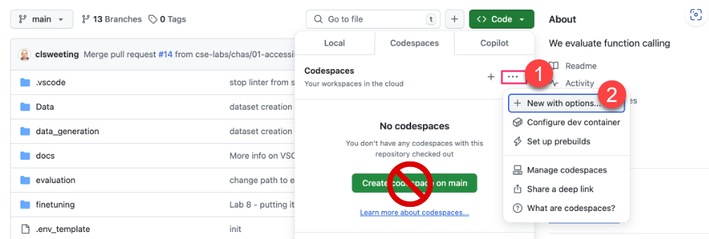
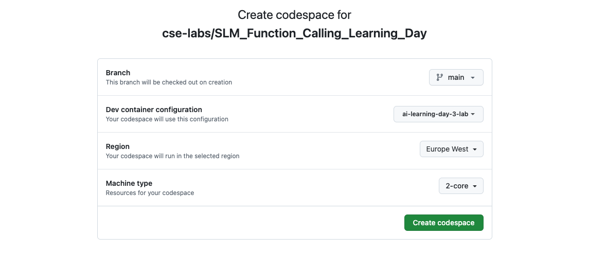
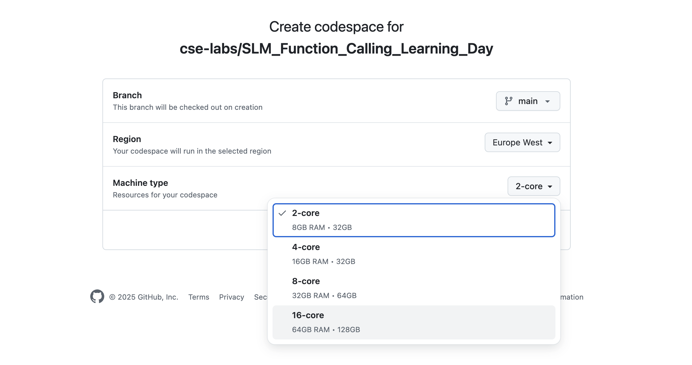
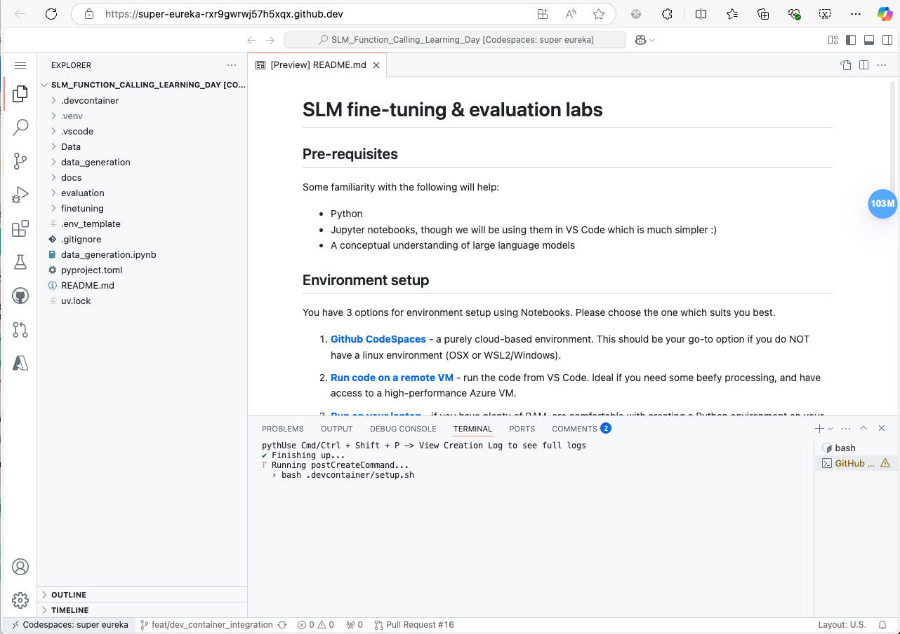
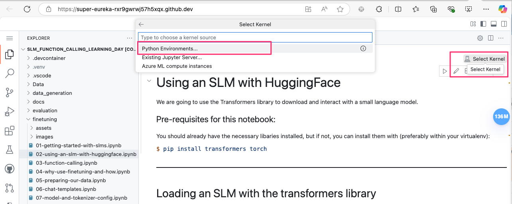
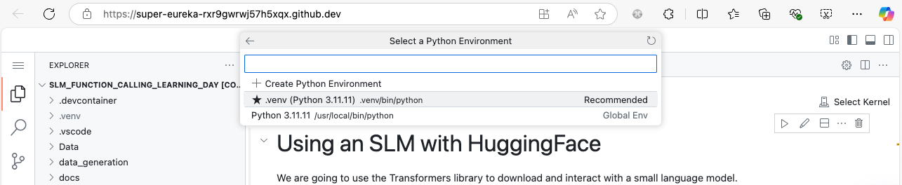
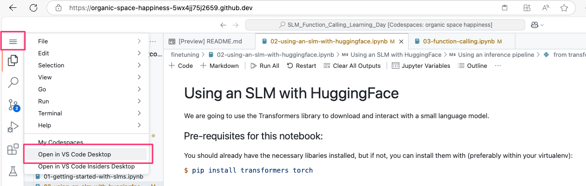
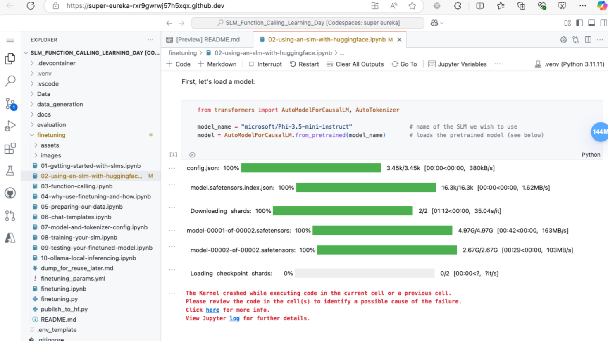
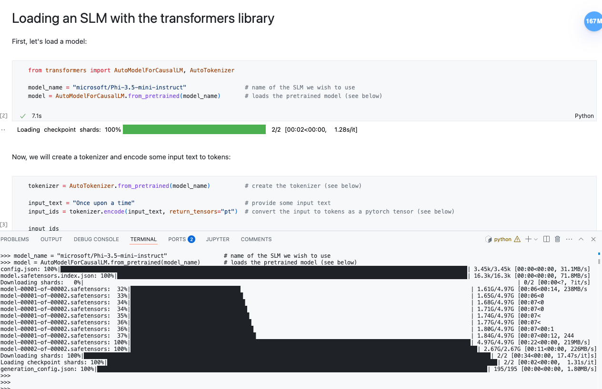
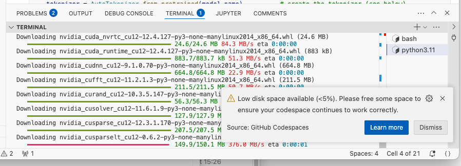

# Running in Github Codespaces

A Github Codespace is a development environment that's hosted in the cloud.  This is the ideal choice if you cannot or would rather not use your local development machine.

The lab has been tested on a Github Codespace and should run fine with the provided devcontainer.

 

IMPORTANT: Fine-tuning may take a long time to complete in Codespaces since it uses CPUs rather than GPUs. This only affects the [the training step](../finetuning/08-training-your-slm.ipynb). Regardless, you will still learn the full process, and a pre-trained model is provided for download when you reach the [testing step](../finetuning/09-testing-your-finetuned-model.ipynb)

## Step by step instructions

### 1. Create your Codespace

Go to the repository and select `Code -> Codespaces (tab)`.  Resist the urge to click the large green button & instead select the elipsis (...) and choose "new with options":

You will then be presented with an options screen.  Again, resist the urge to click the green button:

Select the largest machine.  This is not being gratuitous - language models need lots of memory.  Go with 64GB memory (128GB disk space)

Now you can click the green button 😄

 

### 2. Wait for the Codespace to be created

It may take ~5-10 minutes for the Codespace environment to be created - "patience, grasshopper" - after which you will see something like the UI below. The Codespace comes with a Devcontainer, and if you look closely in the terminal, you'll notice a post-create script running - it's installing all Python dependencies within a virtual environment.

You can ignore any VS Code pop-ups offering to install extensions.

 

### 3. Open a notebook & select a kernel

You can now open a Jupyter notebook (eg. from the 'finetuning' folder).

Each time you open a notebook for the first time, click "select kernel" in the top-right of the notebook, and choose "Python Environments..."

Go with the recommended virtual env (located within your repo's working directory):

You should now be ready to go.  Try running a cell to ensure the everything is running fine:

 

-----------

### Optional - connect from VS Code locally

Instead of using the web UI, you can also connect to the Codespace from your local VS Code:

You will then be prompted to install an extension, followed by logging in & authorizing access.

 

-----------

### Possible Gotchas

In the perfect world, you should encounter no issues. 🤞🍀

However, in case you encounter the issues below, it's often simplest resolved by spinning up a new Codespace in a different region.

#### Kernel crashes

If you see something like this:

There is a page dedicated to this topic - <https://github.com/microsoft/vscode-jupyter/wiki/Kernel-crashes>

You could consider using the Python terminal directly (copying code from the notebook):

... or just try a new Codespace.

 

#### Disk space

Disk space issues can arise due to multiple reasons, including downloading/caching different models.   Rather than trying to clean up the mess, spin up a new Codespace.

