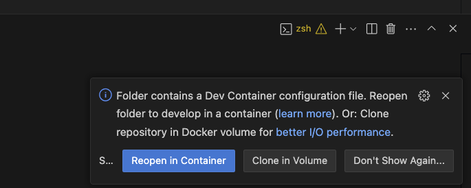
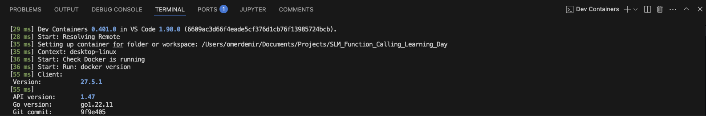

# Running in a Dev Container Locally

A **Dev Container** provides a fully configured development environment that can be used consistently across different machines. This setup is useful if you want to develop locally while ensuring dependencies and configurations remain the same.

The provided **dev container** setup is designed to work on **Mac, Linux, and Windows (WSL2)** using **VS Code** with the **Dev Containers extension**.


IMPORTANT: you will not be able to access the GPU when using Dev Containers on Apple Silicon (e.g., M1, M2, M3, M4 chips). Other platforms (e.g., Intel GPUs) may also not support GPU pass-through in Dev Containers. This only affects the [the training step](../finetuning/08-training-your-slm.ipynb).  In such cases, opt to "NOT open in Dev Container" when opening the repo in VS Code and create the virtualenv using the [local](./env-setup-local.md) 
or [remove](env-setup-remote-vm.md) setup. 

<br>

## Step-by-Step Instructions

### 1. Install Prerequisites

Before setting up the Dev Container, ensure you have the following installed:

#### Mac & Linux
- [Docker](https://docs.docker.com/get-docker/)
- [Visual Studio Code (VS Code)](https://code.visualstudio.com/)
- [Dev Containers extension](https://marketplace.visualstudio.com/items?itemName=ms-vscode-remote.remote-containers)

#### Windows (WSL2)
- [Windows Subsystem for Linux (WSL2)](https://learn.microsoft.com/en-us/windows/wsl/install)
- [Docker Desktop (with WSL2 backend enabled)](https://docs.docker.com/desktop/windows/install/)
- [Visual Studio Code (VS Code)](https://code.visualstudio.com/)
- [Dev Containers extension](https://marketplace.visualstudio.com/items?itemName=ms-vscode-remote.remote-containers)

---

### 2. Open in VS Code
Launch VS Code and open the repository folder:

```sh
code .
```

When prompted, reopen the repository in a Dev Container. If not prompted, manually open the Dev Container:

1. Open the Command Palette (Ctrl+Shift+P or Cmd+Shift+P on Mac).
2. Search for and select **Reopen in Container**.



This will start the Dev Container setup.

### 3. Wait for the Dev Container to Build
Once the container starts, VS Code will:

1. Build the container (this may take a few minutes the first time).
2. Install the required extensions.
3. Run post-setup scripts.

You can check the **Terminal Output** to see the installation progress.



### 5. Open a Jupyter Notebook & Select a Kernel

If your project uses Jupyter Notebooks, follow these steps:

1. Open a notebook (e.g., from the evaluation/finetuning directory).
2. Click "Select Kernel" in the top-right of the notebook.
3. Choose the Python virtual environment within the Dev Container.
4. Try running a cell to verify that everything is working correctly.

## Possible Issues & Troubleshooting

### PyTorch not linked with support for mps devices 

The following error message may occur if you try to access the GPU within a Dev Container on Apple Silicon:

> "RuntimeError: PyTorch is not linked with support for mps devices" 

If your code is running inside a Dev Container in VS Code on a Mac, the Metal Performance Shaders (MPS) backend will not be available because Dev Containers run inside a Docker container, which does not have direct access to macOS’s Metal API.

Metal is a macOS-specific framework that is not exposed inside a Linux-based container (which most VS Code Dev Containers use) - i.e. macOS does not provide GPU passthrough into containers.


#### Workarounds: 
- Don't use a Dev Container!  [Create a virtual env](./env-setup-local.md) on the local machine instead. 
- Alternatively, keep using the Dev Container but set the DEVICE to 'cpu' in the notebooks. 

<br>

--------

### Kernel Crashes in Jupyter Notebooks

If you experience kernel crashes, try:

- Restarting VS Code and reopening the Dev Container.
- Running notebooks from the terminal (python script.py instead of Jupyter).
- Rebuilding the container (Ctrl+Shift+P → "Rebuild Container").


<br>

--------


### Disk Space Issues

If you encounter issues related to **low memory or disk space** while using the Dev Container, you can increase the allocated resources for Docker as described below:

---

#### 🖥️ Mac (Docker Desktop)

By default, Docker on macOS limits the available **CPU, RAM, and disk space**. You can adjust these settings:

1. Open **Docker Desktop**.
2. Click on **Settings** (⚙️).
3. Navigate to **Resources → Advanced**.
4. Adjust the following:
   - **Memory**: Increase to at least **16GB** (if available).
   - **CPUs**: Allocate **at least 4 cores**.
   - **Disk Image Size**: Increase the allocated storage to **100GB or more** if needed, based on models size.
5. Click **Apply & Restart** to save changes.

🔗 **More info**: [Docker Resource Limits on Mac](https://docs.docker.com/desktop/mac/#resources)

---

#### 🖥️ Windows (WSL2 + Docker Desktop)

For Windows users running **WSL2**, Docker resources can be increased via Docker Desktop settings:

1. Open **Docker Desktop**.
2. Go to **Settings** (⚙️).
3. Under **Resources → WSL Integration**, ensure WSL2 is enabled for your distribution.
4. Under **Advanced**, modify:
   - **Memory**: Set **16GB**.
   - **CPUs**: Allocate at least **4 cores**.
   - **Disk Image Size**: Increase storage as needed.
5. Click **Apply & Restart**.

Alternatively, modify the WSL2 settings directly:

1. Open a **PowerShell** window and navigate to:
   ```powershell
   notepad $env:USERPROFILE\.wslconfig
   ```
2. Add or modify the following settings
    ```text
    [wsl2]
    memory=16GB   # Increase memory allocation
    processors=4  # Set number of CPU cores
    swap=8GB      # Allocate swap space
    localhostForwarding=true
    ```
3. Save the file and restart WSL:
    ```powershell
    wsl --shutdown
    ```

----
