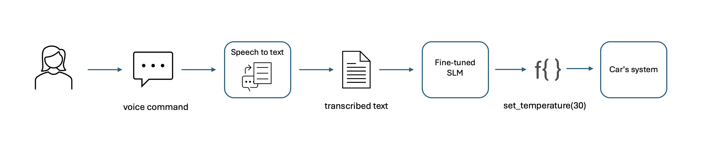

# Fine tuning SLMs

## Context (use case)

You are developing an in-car virtual assistant.  Users will be able to say a command and control limited functionality within the car such as the audio-visual entertainment, aircon, etc. without taking their eyes off the road or their
hands off the steering wheel.

However, not everything said to the in-car assistant should necessarily result in actions being taken.  For example, they may ask for functionality which is not supported (e.g. "speed up" or "emergency stop"), or they may utter nonsense.

You already have speech-to-text capabilities, so you will receive the user's utterance in pure text format.  And your car will be equipped with its own SLM, removing any dependency on connectivity or the cloud, as well as any associated latency.

The challenge is now knowing which hardware to control as a result of what the user has said, and issuing the correct command.

## Instructions

The following notebooks take you through the process from scratch - even if you've never used a LLM or SLM before, you will hopefully be able to get a lot out of this.

What we will cover, and estimated times:

1. [Getting started with SLMs](./01-getting-started-with-slms.ipynb) - 5 mins
2. [Using an SLM with Hugging Face](./02-using-an-slm-with-huggingface.ipynb) - 10 mins
3. [Function calling in the context of language models](./03-function-calling.ipynb) - 10 mins
4. [Why use fine-tuning & how to (high level)](./04-why-use-finetuning-and-how.ipynb) - 5 mins
5. [Preparing our data](./05-preparing-our-data.ipynb) with the Hugging Face datasets library - 5 mins
6. [Chat templates](./06-chat-templates.ipynb) using the tokenizer - 5 mins
7. [Configure your model & tokenizer](./07-model-and-tokenizer-config.ipynb) - 5-10 mins
8. [Training our SLM](./08-training-your-slm.ipynb), putting it all together - 30* mins
9. [Testing the finetuned model](./09-testing-your-finetuned-model.ipynb) - 10 mins
10. [Conclusion](./10-conclusion.md)

* 30 minutes for training notebook assmes you are using a GPU.

We have tried to make this as accessible as possible, so that non-data-scientists can learn.  However, you SHOULD absolutely have questions and we will endeavour to answer them in the workshop.

## Contact

If you have any questions, please reach out to Quy Vu (<vuquy@microsoft.com>)

## References

The code used in this lab was based on what we co-developed with TomTom. Here is the final report that captures our findings and results: [Link to report](https://microsofteur-my.sharepoint.com/:b:/g/personal/vuquy_microsoft_com/EdGwquXsLVFNlp5Q9NYtO3kB1zOYl2mOOCBHKqXWWLWaig?e=Qo0sLp)
